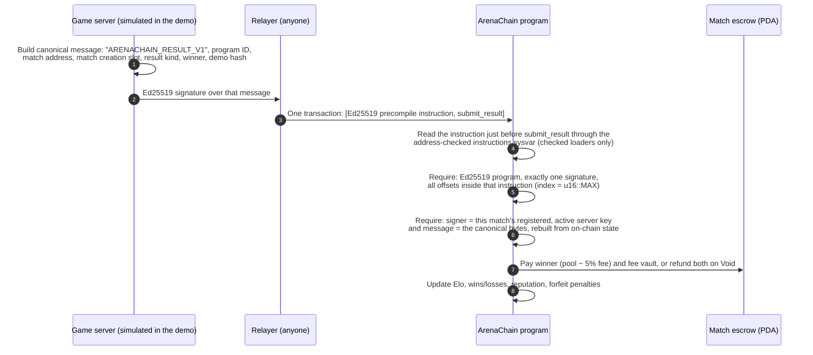
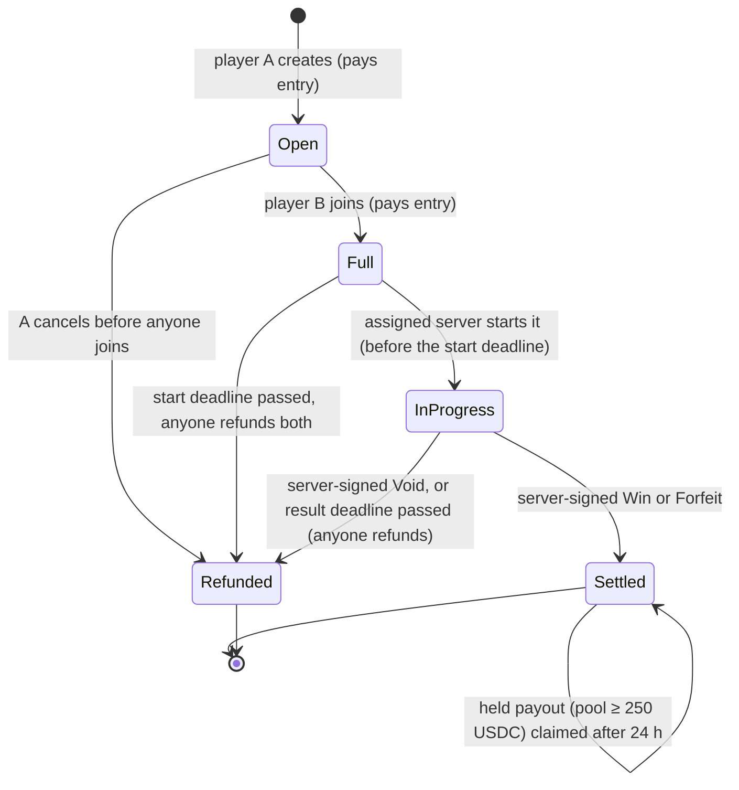

# ArenaChain

**Skill-based CS2 matches with the prize money held by a Solana program, not by us.** Two players each put an entry fee into an escrow account that only the ArenaChain program controls. When the match ends, the game server signs the result with its Ed25519 key. The program checks that signature on-chain and pays the winner straight from escrow: the pool minus a 5% fee, or the whole pool if the opponent quit. No admin, server or website can move escrowed money anywhere except to the match's two players and the fee vault. If no result arrives in time, anyone can refund both players. Ratings, records, reputation and penalties for quitting all live on-chain too.

> **This is a devnet demo with test USDC. No real money is involved.** The CS2 game server is **simulated**: a backend panel in the demo app plays the role of the real result service and signs results the same way it would. See [What is simulated](#what-is-simulated).

## How results are verified

The program never trusts the person who submits a result. It only trusts a signature from the game server registered for that match.



Because the message names the program, the match and the slot the match was created in, a signature for one match can't be replayed on another match, another program or another deployment. The Solana runtime verifies the signature itself (the Ed25519 precompile); the program then checks *who* signed *what*.

## Match lifecycle



- **Win:** the winner gets `pool − fee`, where `fee = pool × 500 / 10 000` rounded down. Nothing stays in the escrow.
- **Forfeit** (a player left and didn't come back, or never joined): the opponent takes the whole pool and the fee is waived.
- **Void** (the server failed and couldn't recover): both players get their entry back.
- **Deadlines:** the server must start a full match within the result window (2 h on devnet), and a started match must settle within the result window from its start. Past either deadline, anyone can refund both players, so funds can't be trapped.
- **Held payouts:** pools of 250 USDC or more wait 24 h before they can be claimed, because VAC bans arrive late. On devnet this threshold sits above demo pool sizes, so demo matches pay out immediately.

## Live on devnet

| | |
|---|---|
| Program | [`HzNHCFVGQu9SKEeAo1UPLV5itD7TSYGoVtmYz4MJeKsw`](https://explorer.solana.com/address/HzNHCFVGQu9SKEeAo1UPLV5itD7TSYGoVtmYz4MJeKsw?cluster=devnet) (Anchor 1.1.2, IDL published) |
| Test USDC mint | [`5NRRbpNy1DD74qhZZt8MBZ1CY3S3qvJVCF9mFYuHMSt3`](https://explorer.solana.com/address/5NRRbpNy1DD74qhZZt8MBZ1CY3S3qvJVCF9mFYuHMSt3?cluster=devnet) (classic SPL Token, 6 decimals, no freeze authority) |
| Verified payout | [Server-signed Win: escrow pays 9.5 USDC to the winner and 0.5 USDC to the fee vault](https://explorer.solana.com/tx/2gRqaWdM9HFXNwJkd3UeWDqreX1xJCVevYVmwV7e7vrXYnanAr1RE3RR7L9kCpnVFzS2ffoLy4HcEkU3JfbzcbTJ?cluster=devnet) |
| Config | `GnRLpE13TYbdLnnHyg3t4eTBcrM5zdyt2gLNneGAcEp3`: 5% fee, 250 USDC hold threshold, 24 h hold, 2 h result window |

All public addresses and signatures are in [`deployments/devnet.json`](deployments/devnet.json).

## Run it locally

Requirements: Ubuntu 24.04+ (or WSL), Rust, Solana CLI 3.1.x, Anchor 1.1.2, Surfpool, Node 22+. `SETUP.md` has a one-shot installer.

**Program and tests** (no keys needed):

```bash
npm install
NO_DNA=1 anchor build
NO_DNA=1 anchor test        # LiteSVM unit tests + Surfpool end-to-end tests
npm test -w app             # demo-app unit tests
```

**Demo app** against the devnet deployment:

```bash
cp app/.env.example app/.env.local
npm run app:build && npm run start -w app     # http://localhost:3000
```

The app's server side needs two devnet keypair files, referenced by path in `app/.env.local`: the treasury (funds the faucet, pays the simulated server's fees) and the registered game-server key. Those belong to the team. To run everything yourself, deploy your own copy to devnet (`solana program deploy`, then `npm run devnet:init`) and register your own server key.

> **`SIMULATED_SERVER=enabled`** turns on the "Simulated CS2 server" buttons. While it's on, **anyone who can reach the app can make the server sign a result** for any live match assigned to the demo server key. That is the point of the demo, and it's why the flag is opt-in. Never enable it on a public deployment or with a real result-service key.

`app/README.md` has the step-by-step for recording a two-wallet match.

## Tests

| Suite | Count | What it covers |
|---|---|---|
| Program unit tests (Rust) | 17 | Fee split for every pool size up to `u64::MAX`, integer Elo table and floor, forfeit ladder and 30-day window |
| LiteSVM program tests | 113 | Every instruction: happy path, wrong signer, wrong server key, replayed and tampered results, Wormhole-style Ed25519 tricks, double settle, refund after payout, wrong mint/vault/fee vault, deadlines to the second, arithmetic extremes, admin bounds and handover |
| Surfpool end-to-end | 5 | Full flows through the generated TypeScript client: payout, held payout and claim, forfeit stats, expiry refund, fee withdrawal |
| Demo-app unit tests | 5 | Every error the UI shows is a readable sentence |
| Devnet run-through | 19 checks | `app/scripts/verify-devnet.ts` plays a two-wallet match against the live devnet program through the app's API |

Several key checks were **mutation-tested**: the check was removed, the matching test was confirmed to fail, and then the check was restored.

## Security decisions

- **Escrow per match.** Each match has its own token vault owned by the match PDA. Only four instructions move money out of escrow (cancel, server result, held-payout claim, expiry refund), and each is constrained to that match's two players and the program's fee vault. No admin path touches escrow.
- **Result verification** follows the pattern that would have stopped the Wormhole exploit. The instructions sysvar is address-checked and read only with the checked loaders. The signature must sit in the same instruction (`u16::MAX` indexes). The signer must be the match's registered, active server. The message is compared byte for byte with one rebuilt from on-chain state.
- **State before money.** Every instruction checks the match's status first and writes the final status before any transfer, so each match settles or refunds exactly once.
- **Exact arithmetic.** Checked u64 math with u128 for the fee, rounding down, and `payout + fee == pool`. Pools that couldn't be represented are rejected when the match is created.
- **Classic SPL Token only, with no freeze authority.** Token-2022 extensions (transfer fees, permanent delegate) and a freeze authority could each break or seize escrow, so config setup rejects them.
- **Funds can't be trapped.** Expiry refunds are permissionless and ignore pause. Admin timing is bounded (hold ≤ 14 days, result window 10 min–24 h). A player can't block settlement by reassigning or closing their own accounts (tested).
- **Admin is limited.** Config can only be initialized by the upgrade authority, so nobody can front-run it. The admin moves to a new key with a two-step handover. Fees can only be withdrawn to the configured treasury.
- **Pre-submission adversarial review.** [`REVIEW.md`](REVIEW.md) lists every finding with its fix commit, including one critical bug: a player could lock both entry fees by reassigning their own wallet. It was fixed and is covered by regression tests.
- **Keys stay server-side.** The demo app loads keys only in `server-only` modules, the client bundle was checked for leaks, and the simulated server is opt-in.

## What is simulated

- **The game server.** No CS2 server or MatchZy integration is wired up yet. The "Simulated CS2 server" panel holds a registered game-server key on the app's backend and signs results with the same code the real result service will use (`clients/js/src/result.ts`). Everything after the signature is real: the on-chain verification, escrow, payout and ratings.
- **The money.** Test USDC from our own devnet mint, handed out by a rate-limited faucet (20 USDC per wallet per day, plus a little SOL for fees).
- **Wallets in our automated runs.** The devnet run-through uses keypairs in place of browser wallets, through the same API and transaction builders the pages use. Wallet-extension sign-in (Phantom, Solflare, Backpack via Wallet Standard) was not part of the automated runs.

## Known limitations & roadmap

- **Dispute freeze:** not built. Held payouts can't yet be frozen when a VAC ban arrives during the hold. Required before mainnet.
- **Real result service:** a TypeScript service that receives MatchZy events from DatHost CS2 servers, deduplicates them, authenticates its webhook, and signs only for matches that are live on-chain and assigned to it.
- **CS2 2v2 Wingman and 5v5:** team escrow and payout splits.
- **Tournaments:** brackets with a prize pool paid out by placement.
- **Multisig:** the upgrade authority and Config admin are still one devnet key. Before mainnet, both move to a Squads multisig (the two-step admin handover is already in the program).
- **Gasless fees:** players currently pay a little SOL for rent and fees. Sponsored transactions would remove that step.
- **Also not built yet:** dual confirmation (both players sign the same winner without the server) and Steam account linking.
- **Accepted for the hackathon:** signed results don't name a cluster (replay across clusters is practically impossible but not excluded by design), and match accounts are never closed (about 0.003 SOL of rent each).
